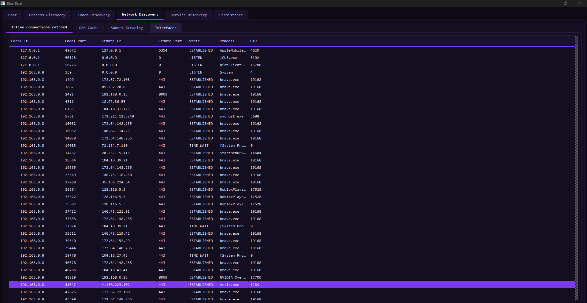

<p align="center">
  
</p>

<p align="center">
  
</p>

# Blue Bear — Red Teaming Host Recon Tool

A Windows-based reconnaissance tool for red team operations and security assessments. Blue Bear gives you a clean, purple-themed dashboard to enumerate everything relevant about a target host — processes, tokens, network, services, and persistence — all in one place.

> ⚠️ **For authorized security testing and educational purposes only. Do not use on systems you do not own or have explicit written permission to test. The author is not responsible for any misuse.**

---

## Features

### 🖥️ Host
A quick overview of the target system at a glance:
- Computer name
- OS version — Windows 10/11 with exact build number
- Architecture — x64, x86, ARM64
- Domain or workgroup membership
- Domain users (requires domain connectivity)
- Live system uptime ticker

---

### 🔍 Process Discovery
A full view of everything running on the system:
- Process name and PID
- All loaded DLLs per process in an expandable tree
- Protected processes are flagged automatically
- Requires **administrator privileges** for full enumeration

---

### 🪙 Token Discovery
Identify privilege escalation paths at a glance:
- **SeImpersonatePrivilege** — flags processes vulnerable to Potato-style token impersonation
- **SeDebugPrivilege** — flags processes that can attach to arbitrary processes (e.g. LSASS)
- **Token Owner** — the user account behind each process token
- **Integrity Level** — Low / Medium / High / System
- **Token Elevation** — full admin token vs. filtered UAC token

---

### 🌐 Network Discovery
Four dedicated views covering the full network picture:

**TCP Connections** — all active and listening connections with local/remote address, port, state, and owning process

**Routing Table** — destination prefixes, subnet lengths, gateways, and route metrics

**Network Adapters** — adapter name, description, operational status, and IP address

**DNS Cache** — a full dump of the local DNS client cache

---

### ⚙️ Service Discovery
A complete picture of everything installed as a service or driver:
- Display name and internal service name
- Current state (Running, Stopped, Paused, etc.)
- Service type (Kernel Driver, Win32 Own Process, Shared Process, etc.)
- Start type (Automatic, Manual, Disabled, etc.)
- Binary path and the account the service runs under
- Service description

---

### 📌 Persistence
Surfaces the most common persistence locations in a single view:

- **Run Keys** — autorun entries for all users and the current user, with full executable paths on hover
- **Scheduled Tasks** — full task enumeration, including hidden tasks
- **Startup Folder** — all files dropped in the current user's Startup folder
- **WMI Event Subscriptions** — registered `__EventFilter` entries, including the WQL query behind each one

All data is gathered live and can be refreshed at any time via the **Refresh button** next to the tab bar — no restart required.

---

## Requirements

- Windows 10 / Windows 11
- **Administrator privileges** (ONLY required for full enumeration. The tool will also work without admin privileges absolutely fine!)
- MSVC 2022 runtime
- Qt 6.x runtime (bundled via `windeployqt`)

---

## Build

Requires Qt 6 with MSVC2022 64-bit and CMake or qmake.

**CMake:**
```
mkdir build
cd build
cmake .. -G "Ninja" -DCMAKE_BUILD_TYPE=Release -DCMAKE_PREFIX_PATH="C:\Qt\6.x.x\msvc2022_64"
cmake --build .
```

**qmake:**
```
mkdir build
cd build
qmake ..\BlueBear.pro -spec win32-msvc "CONFIG+=release"
nmake
```

After building, run `windeployqt` to bundle the Qt DLLs:
```
windeployqt BlueBear.exe
```

---

## Known False Positives

Because Blue Bear enumerates process tokens, privileges, services, and persistence mechanisms, some antivirus engines (including Windows Defender) may flag it as suspicious. This is expected behavior for a recon tool of this kind and not an indication of malicious code — the binary is not code-signed, which also contributes to this.

---

## Contributing / Feature Requests

This project is actively maintained. If you'd like to see a new feature, find a bug, or run into an issue, please **open an Issue** on this repository rather than reaching out directly — it keeps everything tracked in one place and helps other users who may run into the same thing.

---

## Disclaimer

Blue Bear is intended strictly for use in authorized penetration tests, CTF environments, and security research. The author assumes no liability for misuse. Always obtain written permission before running this tool against any system.

---

## Author

**KernelPhantom-010**
